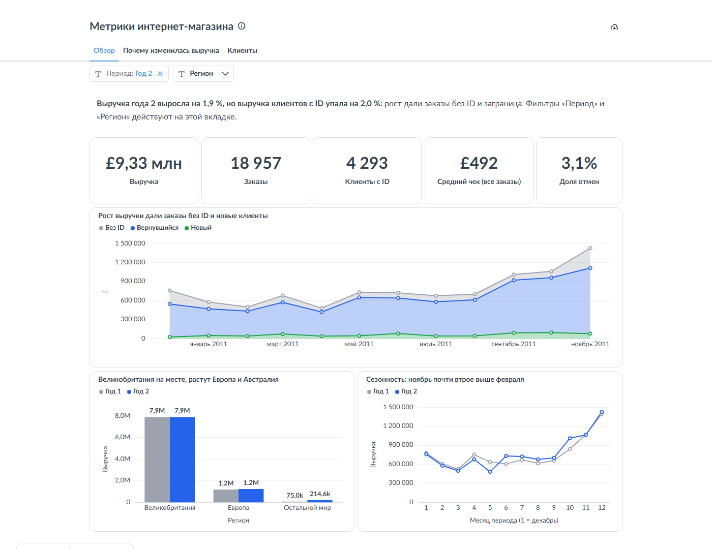
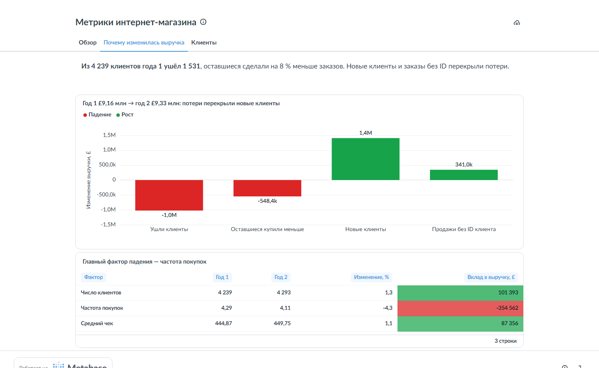
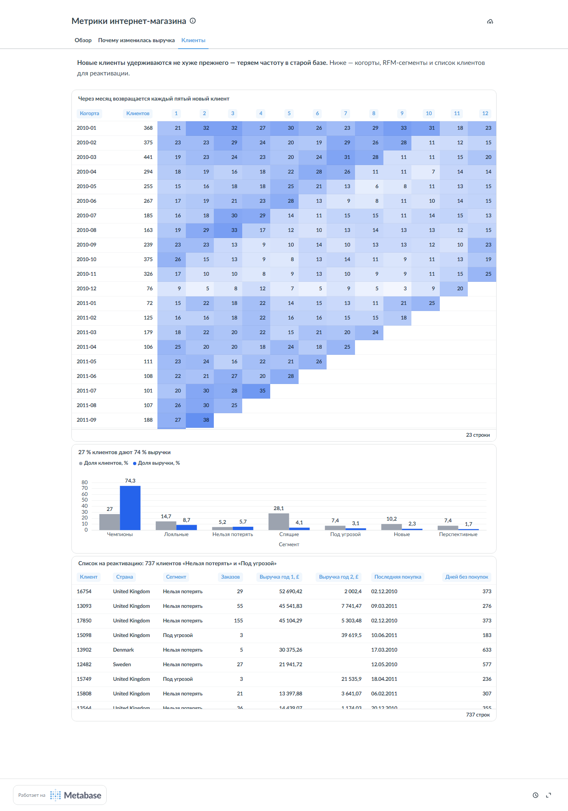

# Метрики интернет-магазина: что случилось с выручкой и что делать

[](https://github.com/Alex91132/online-retail-metrics/actions/workflows/tests.yml)

**[Аналитическая записка](https://alex91132.github.io/online-retail-metrics/)** ·
**[Дашборд в Metabase](#дашборд-в-metabase)** ·
**[Словарь метрик](METRICS.md)** ·
[Сайт-портфолио](https://alex91132.github.io/)

Реальные транзакции британского интернет-магазина подарков (в основном оптовые покупатели) —
[Online Retail II](https://archive.ics.uci.edu/dataset/502/online+retail+ii), 1 млн строк чеков за декабрь 2009 — декабрь 2011.
Вопрос бизнеса: **что произошло с выручкой за второй год, за счёт чего и что с этим делать.**

Путь как в рабочей задаче BI-аналитика: сырые чеки → очистка с измеренным влиянием каждого правила →
SQL-витрины (DuckDB) → словарь метрик и дерево выручки → разбор изменения → дашборд в Metabase, собранный «как код» через API, и записка с решением.

## Вывод

**Выручка выросла на 1,9 % (£9,16 млн → £9,33 млн), но постоянные клиенты стали покупать реже.**

* Выручка клиентов с ID **упала на 2,0 %**. Рост дали заказы без ID клиента (+£341 тыс.) и новые клиенты.
* Из 4 239 клиентов года 1 ушли 1 531 — с ними £1,02 млн. Оставшиеся 2 708 купили на £548 тыс. меньше:
  у них **на 8 % меньше заказов**.
* Разложение «клиенты × заказов на клиента × средний чек»: частота **−4,3 % → −£355 тыс.**,
  число клиентов +£101 тыс., средний чек +£87 тыс.
* Новые клиенты удерживаются не хуже прежнего: через месяц возвращаются 19 % когорт 2010 года и 21 % — 2011-го.
  Выручку теряем на старой базе.
* «Чемпионы» — 27 % клиентов и 74 % выручки. 737 бывших частых покупателей («Нельзя потерять» и «Под угрозой»)
  принесли £1,16 млн в году 1 и £0,28 млн в году 2.
* Великобритания (85 % выручки) не изменилась; растут Европа (+3 %) и Австралия (£29 тыс. → £137 тыс.).

## Что делать

1. **Сначала разобраться с заказами без ID.** Их доля в выручке выросла с 12 % до 15 %, а средний чек — £1 057 против
   £467 у клиентов с ID. Если это постоянные клиенты без входа в аккаунт, часть «падения частоты» — артефакт учёта.
2. **Реактивировать 737 клиентов** из списка на дашборде — и проверить эффект A/B-тестом с контрольной группой.
3. **Добавить в отчётность частоту покупок «Чемпионов»** с порогом тревоги: на месячной выручке её падение не видно.
4. **Австралию и Европу — в отдельные цели**: это единственные растущие регионы.

## Дашборд в Metabase

Три вкладки, фильтры «Период» и «Регион», все карточки — SQL поверх витрин в PostgreSQL. Дашборд не собирается
мышкой, а создаётся скриптом [`bi/setup_metabase.py`](bi/setup_metabase.py) через REST API: коллекция, 13 карточек,
вкладки, фильтры, раскладка и публичная ссылка. Повторный запуск пересоздаёт всё с нуля.

```bash
cd bi && docker compose up -d       # PostgreSQL с витринами из marts/ + Metabase на localhost:3030
cd .. && python bi/setup_metabase.py
```

**Обзор** — KPI года, выручка по месяцам по типу клиента, регионы, сезонность:



**Почему изменилась выручка** — мост год к году и вклад факторов:



**Клиенты** — когорты удержания, RFM-сегменты и список на реактивацию:



Тот же дашборд можно собрать в Yandex DataLens — пошаговая инструкция в [DATALENS.md](DATALENS.md).

## Как сделано

| Шаг | Где |
|---|---|
| Загрузка с проверкой SHA-256 | [`src/retail/data.py`](src/retail/data.py) |
| Очистка: служебные коды, нулевые цены, 34 тыс. дублей; отмены — со знаком минус | [`sql/01_stg_lines.sql`](sql/01_stg_lines.sql), влияние — [`results/cleaning.csv`](results/cleaning.csv) |
| Витрины: заказы, клиенты с RFM, когорты | [`sql/02_marts.sql`](sql/02_marts.sql) |
| Мост выручки и разложение по факторам методом LMDI (вклады в сумме = всё изменение) | [`src/retail/analysis.py`](src/retail/analysis.py) |
| Определения метрик, дерево выручки, пороги RFM | [METRICS.md](METRICS.md) |
| Выгрузки для DataLens | [`marts/`](marts) |
| Дашборд в Metabase как код: Docker, PostgreSQL, карточки и вкладки через API | [`bi/`](bi) |
| Тот же дашборд в DataLens — пошагово | [DATALENS.md](DATALENS.md) |
| Тесты: правила очистки, мост и факторы сходятся точно, удержание когорты в месяце 0 = 100 % | [`tests/`](tests) |

Две ловушки, которые разобраны в записке:

* **Возврат к среднему.** Если разбить оставшихся клиентов по выручке года 1, крупные «упали» на 8–17 %, мелкие «выросли»
  на 36 % — но так выглядел бы и шум. Поэтому в выводе — падение заказов у всех оставшихся, а не у групп.
* **Левое цензурирование.** Данные начинаются в декабре 2009, и «новые» клиенты начала 2010 года — частично старые,
  впервые попавшие в данные. Поэтому мост считается только для года 2, а первая когорта исключена из удержания.

## Запуск

```bash
python -m venv .venv
.venv/Scripts/activate              # Linux/macOS: source .venv/bin/activate
pip install -r requirements.txt
python scripts/build.py             # скачает данные (43,5 МБ, сверит SHA-256) → marts/, results/
python scripts/export_page.py       # данные для docs/
pytest -q
```

## Данные

Chen D. 2012. Online Retail II. UCI Machine Learning Repository,
[archive.ics.uci.edu/dataset/502](https://archive.ics.uci.edu/dataset/502/online+retail+ii), CC BY 4.0.
Сырые данные в репозиторий не входят; витрины в `marts/` — производные от них, под той же лицензией.
Суммы — в фунтах стерлингов.
